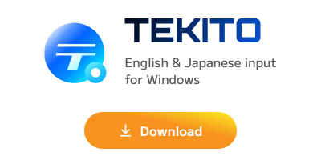
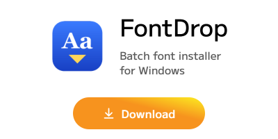

  <a href="https://github.com/Capitata-dev/tekito/releases"><picture><source media="(prefers-color-scheme: dark)" srcset="assets-v1/card-tekito-dark.svg"></picture></a> <a href="https://github.com/Capitata-dev/FontDrop/releases"><picture><source media="(prefers-color-scheme: dark)" srcset="assets-v1/card-fontdrop-dark.svg"></picture></a> <a href="https://capitata-dev.github.io/ime-benchmark-system/"><picture><source media="(prefers-color-scheme: dark)" srcset="assets-v1/card-imebench-dark.svg"></picture></a>

